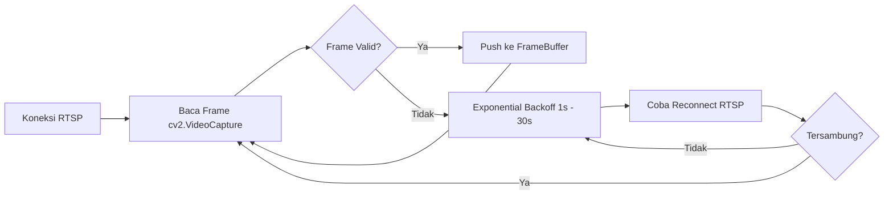
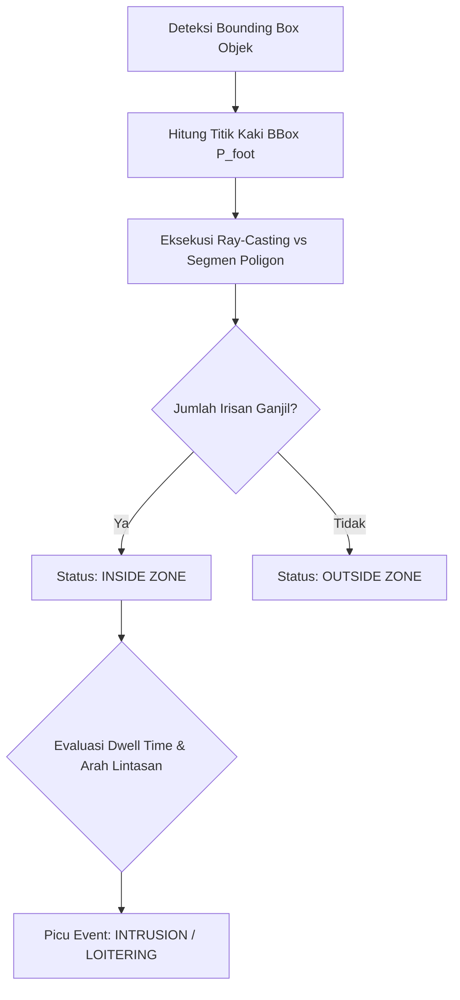
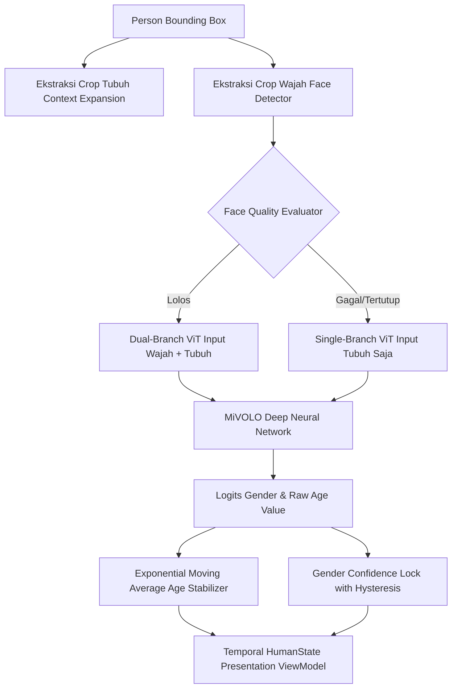

# ENTERPRISE CCTV ANALYTICS PLATFORM
## AI Analytics Engine & Model Pipeline Blueprint

**Dokumen**: AI Analytics Engine Technical Architecture & Model Specification  
**Versi**: 2.0.0 Enterprise Edition  
**Tanggal**: Oktober 2026  
**Klasifikasi**: Spesifikasi Teknis Mesin Cerdas & Pipeline Inferensi  
**Status**: Approved Living Architecture  
**Lokasi Berkas**: `docs/BLUEPRINT_AI_ENGINE.md`  

---

## 1. Executive Summary & Lingkup Domain AI Engine

AI Analytics Engine (`camera_analytics`) adalah subsistem pemrosesan video berkecepatan tinggi yang dirancang untuk beroperasi pada lingkungan edge computing maupun server terpusat dengan akselerasi GPU NVIDIA (CUDA). Subsistem ini bertanggung jawab penuh atas:
1. **Ingesti Video RTSP**: Mengambil dan mendekode video stream dari berbagai sumber kamera IP industri secara stabil.
2. **Inferensi Model Deep Learning**: Menjalankan model deteksi objek, estimasi pose tubuh (keypoint skeletons), dan estimasi atribut demografi secara bersamaan.
3. **Tracking Temporal & Re-Identifikasi**: Melacak lintasan pergerakan objek multi-kamera secara berkesinambungan tanpa kehilangan identitas (*track ID persistence*).
4. **Analitik Geometri Spasial**: Mengevaluasi koordinat batas poligon spasial secara presisi untuk mendeteksi pelanggaran keamanan (intrusi, tripwire, loitering).
5. **Penerbitan Event Asinkron**: Mengemas hasil inferensi ke dalam kontrak event terstandarisasi dan mempublikasikannya ke message broker AMQP (RabbitMQ) dan WebSocket gateway.

---

## 2. Arsitektur Threading & Model Konkurensi Asinkron

AI Engine menggunakan arsitektur *multi-threaded decoupled pipeline* untuk mencegah pemblokiran I/O jaringan terhadap pemrosesan tensor GPU:

```
[RTSP Camera Stream]
        │
        ▼ (Thread 1: Ingestion Thread)
[ReaderWorker / VideoReader]
        │
        ▼ (In-Memory Queue: drop oldest on full)
[Circular FrameBuffer (deque maxlen=30)]
        │
        ▼ (Thread 2: GPU Worker Thread)
[PipelineExecutionWorker (YOLO Inference)]
        │
        ├────────────────────────┬────────────────────────┐
        ▼                        ▼                        ▼
[YOLOv8 / Pose]          [ByteTrack + ReID]       [MiVOLO Demographics]
        │                        │                        │
        └────────────────────────┼────────────────────────┘
                                 │
                                 ▼
                     [ZoneEngine Ray-Casting]
                                 │
                                 ▼ (Thread 3: Event Bus Thread)
                       [EventBus Dispatcher]
                                 │
                 ┌───────────────┴───────────────┐
                 ▼                               ▼
     [RabbitMQ AMQP Publisher]       [SignalR Telemetry Client]
```

### Karakteristik Thread:
* **`MainThread`**: Mengatur inisialisasi lingkungan, pembacaan konfigurasi bootstrap, pendaftaran sinyal terminasi OS (`SIGINT`, `SIGTERM`), dan *graceful teardown*.
* **`ReaderWorker` (Thread I/O)**: Menjalankan loop OpenCV `cv2.VideoCapture` untuk mendekode frame RTSP H.264/H.265. Beroperasi independen terhadap kecepatan inferensi GPU.
* **`FrameBuffer`**: Struktur antrean ring buffer berbasis `collections.deque(maxlen=30)`. Jika GPU mengalami pelambatan sesaat, frame terlama secara otomatis dibuang (*drop oldest frame*) untuk memastikan latensi stream tetap berada di bawah 200 ms dan menghindari memory leak.
* **`PipelineExecutionWorker` (Thread GPU)**: Mengambil frame dari buffer, mengubah format BGR ke tensor RGB, mengirimkan memori ke CUDA, mengeksekusi model, dan memanggil ZoneEngine.
* **`EventBus` (Thread Publisher)**: Mengirimkan payload JSON event ke RabbitMQ exchange dan SignalR hub tanpa mengganggu siklus deteksi frame berikutnya.

---

## 3. Pipeline Ingesti Video & Ketahanan Aliran (*Stream Resilience*)



* **Protokol Transportasi**: Mendukung RTSP melalui TCP (mengurangi packet loss) atau UDP (latensi minimal).
* **Mekanisme Auto-Reconnect**: Apabila kamera IP mengalami kehilangan daya atau gangguan switch jaringan, `ReaderWorker` menerapkan algoritma *Exponential Backoff with Jitter* (interval 1s, 2s, 4s, 8s, maksimum 30s) hingga koneksi video pulih secara transparan tanpa mematikan proses AI Engine.
* **Dynamic Frame Sampling**: Engine dapat dikonfigurasi untuk memproses frame penuh (25 FPS) atau mode efisiensi (5-10 FPS) guna memangkas konsumsi daya GPU pada kamera non-kritis.

---

## 4. Tumpukan Model Inferensi Deep Learning (*Model Stack*)

Platform menggunakan kombinasi model state-of-the-art yang telah dioptimasi untuk eksekusi berkecepatan tinggi:

| Nama Model | Arsitektur Dasar | Input Tensor | Bobot Model Aktif | Target Deteksi / Output |
| :--- | :--- | :--- | :--- | :--- |
| **YOLO Object Detector** | Ultralytics YOLOv8 / YOLOv11 | $640 \times 640$ RGB (FP16/FP32) | `yolov8n.pt` / `yolo11m.pt` | Bounding Box, Kelas Objek (`person`, `car`, `motorcycle`, `truck`), Tingkat Keyakinan (*Confidence Score*). |
| **YOLO Pose Estimator** | YOLOv8-Pose Architecture | $640 \times 640$ RGB | `yolov8n-pose.pt`, `yolo26m-pose.pt` | 17 Keypoints Kerangka Tubuh (Nose, Eyes, Shoulders, Elbows, Wrists, Hips, Knees, Ankles). |
| **Multi-Object Tracker** | ByteTrack + Deep ReID | Koordinat BBox + Feature Vector | Pytorch CUDA Embedder | Pelacakan Track ID unik berkesinambungan dan pemulihan track saat terjadi oklusi (*track association*). |
| **MiVOLO Demographics** | Dual-Branch Vision Transformer (ViT) | $224 \times 224$ (Face) + $224 \times 224$ (Body) | `mivolo_imdb_cross_person_4.22_r224.pth` | Estimasi Umur (regresi linear nilai mengambang) dan Klasifikasi Gender (distribusi probabilitas biner). |

---

## 5. Mesin Geometri Spasial Inti (*Polygon Zone Engine Core*)

`ZoneEngine` adalah pustaka matematika murni yang mengevaluasi pergerakan objek terhadap poligon zona yang digambar oleh administrator:

### 5.1 Algoritma Ray-Casting Point-in-Polygon (PIP)
Untuk menentukan apakah objek berada di dalam zona poligon:
1. Titik acuan spasial objek diambil dari **titik tengah kaki terbawah** bounding box:
   $$P_{\text{foot}} = \left( x_{\text{center}}, y_{\text{bottom}} \right) = \left( \frac{x_{\min} + x_{\max}}{2}, y_{\max} \right)$$
2. Garis sinar horisontal semu (*ray*) diproyeksikan dari $P_{\text{foot}}$ menuju tak hingga ($+\infty, y$).
3. Jika jumlah perpotongan sinar dengan segmen garis poligon bernilai **ganjil**, maka objek dinyatakan berada **DI DALAM** zona. Jika **genap**, objek berada **DI LUAR**.



### 5.2 Aturan Analitik yang Didukung
* **INTRUSION (Penyusupan Zona Terlarang)**: Objek kelas tertentu (misal: `person`) memasuki area poligon terlarang dalam jadwal aktif.
* **TRIPWIRE (Pelanggaran Garis Batas Virtual)**: Objek memotong segmen garis virtual dengan filter arah tertentu (misal: *arah Masuk dilarang, arah Keluar diizinkan*).
* **LOITERING (Mondar-mandir / Mengintai)**: Objek bertahan di dalam area zona melebihi batas waktu toleransi (*dwell time threshold*, contoh $> 60\text{ detik}$) dengan pola lintasan acak.
* **PEOPLE / VEHICLE COUNTING**: Penghitungan akumulatif lintas garis batas dua arah dengan de-duplikasi berbasis Track ID untuk mencegah penghitungan ganda.

---

## 6. Subsistem Analitik Demografi Manusia (MiVOLO Specialist)

AI Engine menyertakan subsistem analitik manusia tingkat lanjut untuk estimasi profil demografi secara real-time tanpa perlu memposisikan wajah langsung menghadap kamera (*in-the-wild CCTV analysis*):



1. **Context Expansion Body Crop**: Memotong area tubuh dengan margin 10% untuk mempertahankan konteks pakaian dan postur tubuh.
2. **Quality Gating**: Mengevaluasi resolusi piksel wajah dan tingkat keburaman (*Laplacian variance blur score*). Jika wajah membelakangi kamera, engine beralih menggunakan visual tubuh (*body-only inference*).
3. **Exponential Moving Average (EMA) Age Stabilizer**: Mencegah angka umur melompat-lompat antar frame dengan formula:
   $$\text{Age}_{t} = \alpha \cdot \text{Age}_{\text{new}} + (1 - \alpha) \cdot \text{Age}_{t-1}, \quad \text{dimana } \alpha = 0.15$$
4. **Gender Confidence Lock**: Begitu probabilitas gender melampaui ambang batas keyakinan ($> 0.85$) selama 10 frame berturut-turut, status gender dikunci (*hysteresis lock*) untuk track ID tersebut guna menjaga stabilitas data.

---

## 7. Kontrak Event & Skema Penerbitan Telemetri

Setiap event pelanggaran yang dihasilkan oleh AI Engine dipublikasikan dalam skema JSON terstruktur ke RabbitMQ exchange `cctv.analytics.events`:

```json
{
  "eventId": "e92f1b0a-7b3e-4d51-9238-8a9d1c02e5b7",
  "eventType": "ZONE_INTRUSION",
  "eventVersion": "1.0",
  "timestamp": "2026-10-02T16:30:00.125Z",
  "engineId": "99e20ace-2f16-4f8e-b220-bf064eb0f242",
  "cameraId": "3fa85f64-5717-4562-b3fc-2c963f66afa6",
  "roomId": "7ca32e12-8819-4822-a9b1-314981d09aa1",
  "zoneId": "c108e4d2-28a1-4320-b09e-71b3e1c6679b",
  "ruleType": "INTRUSION",
  "severity": "CRITICAL",
  "track": {
    "trackId": 104,
    "objectClass": "person",
    "confidence": 0.942,
    "boundingBox": {
      "xMin": 0.452,
      "yMin": 0.312,
      "xMax": 0.589,
      "yMax": 0.785
    },
    "demographics": {
      "estimatedAge": 28.4,
      "gender": "MALE",
      "genderConfidence": 0.96
    }
  },
  "metadata": {
    "inferenceLatencyMs": 14.8,
    "fps": 25.2,
    "hardware": "NVIDIA GeForce RTX 4090"
  }
}
```

---

## 8. Mode Operasi Mandiri (*Standalone Mode*)

Selain terhubung dengan Backend API pusat, AI Engine memiliki fitur operasi mandiri (*standalone mode*) menggunakan berkas konfigurasi lokal `standalone.json`:
* **Tujuan**: Memungkinkan pengujian edge di lokasi tanpa koneksi internet atau staging mandiri.
* **Perilaku**: Engine membaca konfigurasi kamera RTSP lokal, file video MP4 uji coba, dan definisi poligon zona langsung dari JSON disk tanpa memanggil HTTP bootstrap backend.
* **Perintah Eksekusi**:
  ```bash
  python -m camera_analytics.main --config config/standalone.json --headless
  ```

---

## 9. Metrik Kinerja & Benchmark Perangkat Keras

Hasil pengukuran pada resolusi $1920 \times 1080$ (1080p Stream) dengan GPU NVIDIA RTX 4090:
* **Kecepatan Inferensi YOLOv8n**: $3.2\text{ ms / frame}$ ($> 300\text{ FPS}$).
* **Kecepatan Inferensi YOLOv8-Pose**: $6.8\text{ ms / frame}$ ($147\text{ FPS}$).
* **Kecepatan ZoneEngine (PIP 10 Zona)**: $< 0.1\text{ ms / frame}$.
* **Throughput Pipeline Penuh (Deteksi + Pose + Tracking + Zone PIP)**: **$65 - 80\text{ FPS}$ per stream**, memungkinkan satu GPU melayani hingga **8 - 12 kamera live stream simultan** pada 20 FPS tanpa frame drop.
