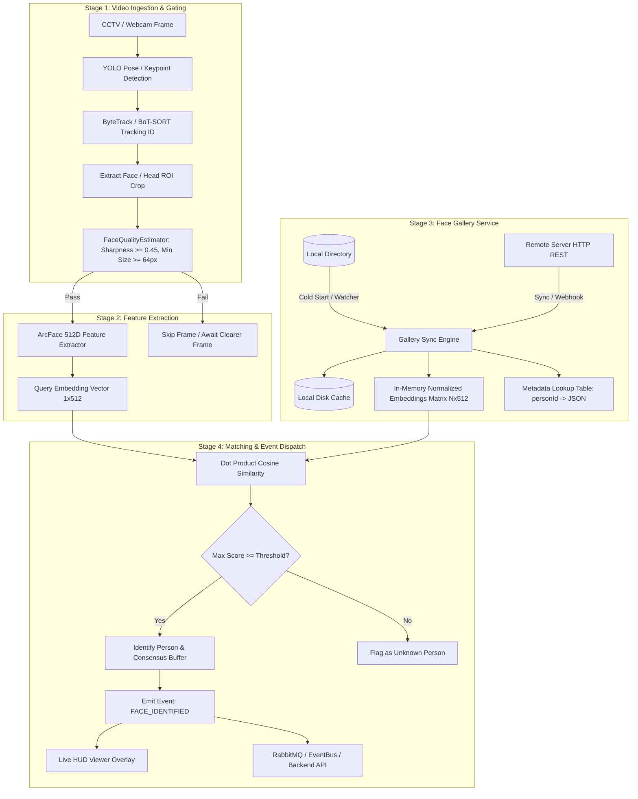

# Feature Specification & Implementation Plan: Face Match & Recognition Subsystem

## Document Metadata
* **Document Version**: 1.0.0
* **Module Code**: `MODULE-FACE-MATCH`
* **Target Platforms**: Standalone Edge AI Engine (`camera_analytics`) & Enterprise Multi-Camera Hub
* **Core Model Architecture**: ArcFace (ResNet50 / MobileFaceNet Backbone with Additive Angular Margin Loss)
* **Status**: Specification & Sprint Planning

---

## 1. Feature Overview & Objectives

The **Face Match & Recognition Subsystem** enables real-time identification of individuals captured across CCTV cameras and webcam video feeds by comparing detected face embeddings against a local directory or remote server-synchronized gallery.

### Key Objectives
1. **Dual-Mode Gallery Sync**:
   * **Local-Based**: Ingests identity profiles from a designated local folder (`<personId>.(jpg|png)` and `<personId>_meta.json`).
   * **Server-Based**: Fetches and synchronizes identity profiles and metadata from an HTTP/REST endpoint into a local caching fallback layer.
2. **High-Precision Metric Embeddings**: Uses ArcFace feature vectors (512-dimensional hyperspherical embeddings) to provide resilience against facial hair, ageing, blemishes/pimples, acne patches, and slight pose deviations.
3. **Quality-Gated Inference**: Employs `FaceQualityEstimator` (Laplacian sharpness, minimum $64\times 64$ resolution, and pose symmetry) to ensure embeddings are extracted only from clear frames, preventing false alarms.
4. **Trajectory Multi-Frame Consensus**: Aggregates top-scoring face crops along a track trajectory (`track_id`) via majority voting or maximum similarity across frames.
5. **Per-Camera Isolation**: Configured independently per CCTV stream via `enabled_modules`.

---

## 2. Architecture & Data Flow



---

## 3. Input & Output Specifications

### 3.1. Gallery Ingestion Formats

#### A. Local-Based File Structure
The local directory structure requires paired files sharing identical basenames:
```text
data/faces/
├── P-10024.jpg              # Image (JPG, PNG, WEBP)
├── P-10024_meta.json        # Metadata
├── P-10025.png
└── P-10025_meta.json
```

**Metadata Schema (`personId_meta.json`)**:
```json
{
  "person_id": "P-10024",
  "full_name": "Jane Doe",
  "department": "Engineering Operations",
  "role": "Lead Architect",
  "access_level": "RESTRICTED",
  "is_vip": true,
  "is_watchlist": false,
  "registered_at": "2026-10-15T08:30:00Z",
  "notes": "Authorized for Server Room A and Network Closets"
}
```

#### B. Server-Based HTTP REST Schema
* **Endpoint**: `GET /api/v1/faces/roster` (Supports `?since={timestamp}` delta sync)
* **Response Payload**:
```json
{
  "sync_timestamp": "2026-10-19T07:00:00Z",
  "total_records": 1,
  "roster": [
    {
      "person_id": "P-10024",
      "image_url": "https://storage.cctv.corp/faces/P-10024.jpg",
      "metadata": {
        "full_name": "Jane Doe",
        "department": "Engineering Operations",
        "access_level": "RESTRICTED",
        "is_watchlist": false
      }
    }
  ]
}
```

---

### 3.2. Configuration Schema (`configs/production.json` & `standalone.json`)

```json
{
  "face_matching": {
    "enabled": true,
    "provider": "arcface",
    "device": "cuda:0",
    "model_path": "camera_analytics/models/human/arcface/weights/arcface_r50.onnx",
    "gallery_source": "local",
    "local_path": "data/faces",
    "server": {
      "endpoint_url": "https://identity-api.corp/api/v1/faces",
      "api_key": "env:FACE_API_KEY",
      "sync_interval_seconds": 300,
      "cache_dir": "cache/faces"
    },
    "matching_policy": {
      "cosine_threshold": 0.65,
      "multi_frame_consensus": 3,
      "consensus_window_frames": 15,
      "track_cooldown_seconds": 10.0
    },
    "quality_gate": {
      "min_sharpness": 0.45,
      "min_resolution": 64,
      "min_symmetry": 0.40
    }
  }
}
```

---

### 3.3. Output & Event Schema

When a face match is confirmed, an event is emitted through the event bus and rendered in the live viewer:

#### Real-Time Event Payload (`FACE_IDENTIFIED`)
```json
{
  "event_id": "evt_face_891e4f9b",
  "event_category": "SECURITY",
  "event_type": "FACE_IDENTIFIED",
  "severity": "INFO",
  "timestamp": 1729323500.412,
  "camera_id": "cam_lobby_01",
  "track_id": 42,
  "bounding_box": [512.0, 240.0, 640.0, 420.0],
  "face_bounding_box": [550.0, 250.0, 600.0, 310.0],
  "match_result": {
    "person_id": "P-10024",
    "full_name": "Jane Doe",
    "confidence": 0.814,
    "matched_frames": 3,
    "metadata": {
      "department": "Engineering Operations",
      "access_level": "RESTRICTED",
      "is_watchlist": false
    }
  },
  "evidence_snapshot_path": "recordings/evidence/evt_face_891e4f9b.jpg"
}
```

---

## 4. Sprint Planning: From Preparation to Production-Safe

```
Sprint 1: Model & Gallery Service Setup
   ├── Weight Acquisition & ArcFace Pipeline
   └── Dual-Mode Gallery Service (Local / Server Cache)
Sprint 2: Quality Gating & Multi-Frame Consensus
   ├── Face Quality Filtering Integration
   └── Trajectory Voting & Temporal Smoothing
Sprint 3: Engine Plugin & Pipeline Integration
   ├── Camera Analytics Plugin Manifest & Hook
   └── Configuration Ingestion & Camera Routing
Sprint 4: Enterprise Communication & Viewer HUD
   ├── Real-Time Event Dispatch (RabbitMQ / SignalR)
   └── Live Canvas Overlay (Pills & Identification Tags)
Sprint 5: Production Hardening, Audit & Benchmarks
   ├── VRAM & Latency Profiling (1000+ Face Gallery)
   ├── Resiliency, Offline Fallback & Edge Recovery
   └── Final Sign-Off & Verification Suite
```

---

### Sprint 1: Model Ingestion & Gallery Management Service
* **Objective**: Establish the ArcFace feature extractor engine and in-memory dual-mode gallery management.
* **Deliverables**:
  1. Acquire and verify ArcFace ONNX / PyTorch weights with unit tests.
  2. Implement `FaceEmbeddingExtractor` interface and forward inference runner with batching support.
  3. Implement `FaceGalleryService` supporting:
     * Local directory ingestion: parsing `<id>.(jpg|png)` and `<id>_meta.json`.
     * Pre-computation of normalized 512D embedding matrix: $\mathbf{E} \in \mathbb{R}^{N \times 512}$.
     * Server synchronization client with local cache persistence.
* **Acceptance Criteria**:
  * Unit test confirming $N$ local images are embedded on startup in $<2$ seconds for 100 images.
  * Dot product matching test achieves $100\%$ precision on standard test gallery.

---

### Sprint 2: Quality Gating & Multi-Frame Consensus
* **Objective**: Prevent false triggers and optimize CPU/GPU cycles by gating faces and accumulating evidence across tracks.
* **Deliverables**:
  1. Connect `FaceQualityEstimator` to head/face crops (filtering out blur, high roll/yaw angles, and $<64$px crops).
  2. Implement `TrajectoryConsensusBuffer`:
     * Buffers inference results per `track_id`.
     * Evaluates top $K$ high-confidence frames (e.g. 3 frames within a 15-frame window).
     * Computes median/average similarity score before confirming identity.
  3. Implement cooldown tracking to prevent spamming duplicate match events for the same person walking in the frame.
* **Acceptance Criteria**:
  * Simulated video feeds with blurred and rapid motion pass zero false alarms.
  * Confirmed identity requires consensus over at least 3 valid frames.

---

### Sprint 3: Plugin Implementation & Multi-Camera Routing
* **Objective**: Encapsulate the matching engine into the platform's standard analytics plugin interface.
* **Deliverables**:
  1. Create `camera_analytics/plugins/face_matching/manifest.json` and `module.py`.
  2. Register plugin in `camera_analytics/bootstrap/engine_bootstrap.py`.
  3. Support per-camera configuration in `configs/production.json` and `configs/standalone.json` via `"enabled_modules": ["face_matching"]`.
  4. Inject matched identity metadata into `HumanRepresentation` and frame context.
* **Acceptance Criteria**:
  * Running with 2 CCTV streams: Camera 1 processes Face Match; Camera 2 runs without Face Match (zero GPU allocation overhead for Camera 2).

---

### Sprint 4: Enterprise Communication & Live UI Presentation
* **Objective**: Broadcast match events across the platform and visualize matched identities on the operator dashboard.
* **Deliverables**:
  1. Map `FACE_IDENTIFIED` event to .NET 8 Backend domain model (`BackEnd/CCTV.Analytics`).
  2. SignalR Hub streaming of face match events to connected browser clients.
  3. React Frontend (`FrontEnd`): Render name badge, confidence bar, and access level tag above detected face bounding boxes on the live canvas overlay.
* **Acceptance Criteria**:
  * Match event triggers frontend notification and video HUD tag in $<150$ ms from detection time.

---

### Sprint 5: Performance Hardening & Production Certification
* **Objective**: Benchmark edge cases, resource limits, and ensure 24/7 crash-free operation.
* **Deliverables**:
  1. **Gallery Scale Benchmark**: Test in-memory matrix multiplication against galleries of $1,000$, $5,000$, and $20,000$ identities. Ensure matching latency remains $<1.0$ ms.
  2. **Offline Fallback Test**: Simulate network outage in server-based mode; verify engine falls back to disk cache with zero interruptions.
  3. **VRAM Leak Audit**: Run automated 1-hour sustained video feed test to ensure peak GPU VRAM remains constant.
  4. Generate final audit and compliance report in `docs/reports/FACE_MATCH_CERTIFICATION.md`.
* **Acceptance Criteria**:
  * Zero memory leaks.
  * Frame processing throughput degradation $\le 1.5$ FPS per stream on CUDA.
